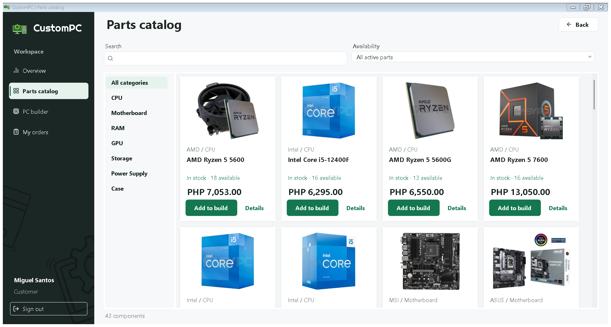

# CustomPC

A C# Windows Forms application for configuring PC builds and managing a computer store's inventory and orders. Customers select components, Staff records stock and payments, and Admin manages products, accounts, and reports.



## Features

- Product catalog with photographs, search, and availability filters.
- PC builder with socket, memory, graphics, and power checks.
- Customer orders with stock reservations and a 24-hour payment deadline.
- Staff stock adjustments, payment confirmation, assembly, and pickup tracking.
- Admin product and account management, dashboards, and CSV reports.
- Receipts, activity history, and database/photo backups.

## Download

Download the Windows package from [Releases](https://github.com/Keith11-1313/CustomPC/releases), extract the ZIP, and open `CustomPC.exe`. Keep the extracted files together. The self-contained package includes .NET.

Requires **64-bit Windows 10 build 19041 or later, or Windows 11**. See [Installation](docs/INSTALLATION.md) for setup and data transfer.

## Build from source

Install the **.NET 10 SDK**. For Visual Studio, install the **.NET desktop development** workload and open `CustomPC.slnx`.

From the repository root:

```powershell
dotnet restore CustomPC.slnx
dotnet build CustomPC.slnx -c Release
dotnet run --project CustomPC/CustomPC.csproj
```

The first run creates an administrator when no accounts exist. Store data is ignored by Git, so cloning does not include an existing catalog or accounts.

## Documentation

<<<<<<< Updated upstream
A missing/empty database opens **Set up CustomPC** to create an administrator. It does not recreate the researched catalog. `CUSTOMPC_DEMO_MODE=1` explicitly enables separate practice fixtures; normal startup does not create demo accounts or stock.
=======
| Guide | Contents |
| --- | --- |
| [Installation](docs/INSTALLATION.md) | Run, build, publish, and transfer data |
| [User guide](docs/STORE_GUIDE.md) | Accounts, orders, inventory, reports, and recovery |
| [Roles](docs/ROLES.md) | Guest, Customer, Staff, and Admin permissions |
| [Technical overview](docs/TECHNICAL_OVERVIEW.md) | Architecture, database, dependencies, and business rules |
| [Testing](docs/VALIDATION.md) | Manual checks and validation limits |
| [Developer docs](docs/README.md#development) | Code lessons, reference, and layout notes |
| [Credits](docs/CREDITS.md) | Libraries, fonts, icons, and product sources |

## Scope

CustomPC uses a local SQLite database on one Windows workstation. Separate installations do not synchronize. Payment and pickup happen at the store. Compatibility checks use saved specifications; staff still checks physical fit and BIOS support. Unpaid-order expiry runs while the app is open or when it next starts.

## Issues

Report bugs through [Issues](https://github.com/Keith11-1313/CustomPC/issues). Include the affected screen, reproduction steps, expected and actual results, and Windows version. Leave passwords and private customer records out of attachments.
>>>>>>> Stashed changes
